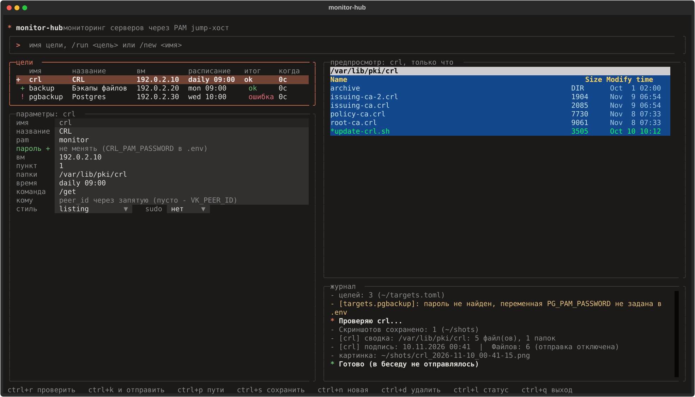

# monitor-hub

One daemon and one list of targets, so your team chat gets a fresh picture every morning: what is in the
backup folders on your servers and whether the success e-mails arrived. It logs in to machines (through
a PAM jump host or directly over ssh), takes `ls -la`, renders a Midnight Commander style picture and posts
it to a VK or Telegram chat. It also reads backup e-mails from IMAP and checks them against a schedule.
Everything is configured in a terminal UI or in plain files.



## Features

- Folder listings: several paths per login, three report styles, stale-file marks, optional `sudo -n`.
- Login: through a PAM gateway (shared or per target) or direct ssh with login and password.
- Mail targets: IMAP, expected machines by weekday (`mon`, `daily`, `sun#1`), night window, status from the subject.
- Messengers: VK or Telegram (`MESSENGER` in `.env`), per-target recipients.
- Chat commands: per-target `/get`, `/pg`, ..., plus `/run <target>`, `/targets`, `/help`; allowed users only.
- TUI: targets, full editor, preview, log, urgent folder view (`/ls`), live view (`/live top`).
- Reliability: timeouts, per-target threads and locks, watchdog message, gateway login limiter.

## Quick start

Python 3.11+ and `openssh-client` are required.

```
python3 -m venv venv
venv/bin/pip install -r requirements-tui.txt
cp targets.example.toml targets.toml
cp .env.example .env && chmod 600 .env
./monitor-hub tui
./monitor-hub validate
./monitor-hub check <target> --no-send
./monitor-hub start
```

Target examples (PAM, direct ssh, own gateway, mail) are in [targets.example.toml](targets.example.toml).
Passwords never go into `targets.toml`: a target names an environment variable (`password_env`) kept in `.env`.

CLI: `validate`, `list`, `check`, `ls <target> <path>`, `live <target> <preset|command>`, `check-paths`,
`tui`, `run`, `start`, `stop`, `restart`, `status`, `logs`. Live view repeats a batch command
(`top -b`, `df`, ...) within one login; it is not a terminal emulator.

The schedule uses the daemon's local time zone. Missed runs are not made up after downtime.

More: [docs/PAM.md](docs/PAM.md), [docs/TROUBLESHOOTING.md](docs/TROUBLESHOOTING.md),
[DESIGN.md](DESIGN.md), [SECURITY.md](SECURITY.md), [CONTRIBUTING.md](CONTRIBUTING.md).
The main documentation is in Russian ([README.md](README.md)).

## License

[PolyForm Noncommercial 1.0.0](LICENSE): free for noncommercial use; commercial use needs the author's permission.
