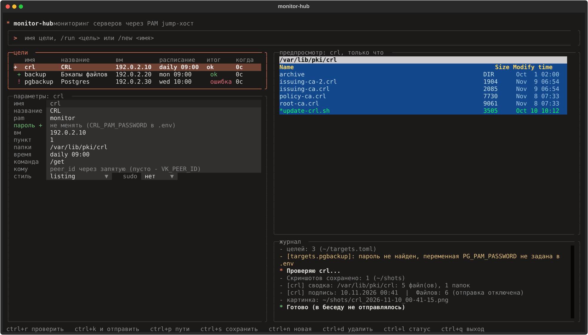

# monitor-hub

Один демон и один список целей для мониторинга серверов через PAM jump-хост:
заходит на ВМ, снимает `ls -la` каталогов, рисует картинку в стиле Midnight
Commander и шлёт в беседу ВКонтакте. Новая ВМ или папка - это блок в
`targets.toml`, а не новый скрипт.



Требуется Python 3.10 или новее. Устройство и решения: [DESIGN.md](DESIGN.md), изменения: [CHANGELOG.md](CHANGELOG.md).

## Быстрый старт

```
python3 -m venv venv
venv/bin/pip install -r requirements.txt
cp targets.example.toml targets.toml      # цели: ВМ, папки, расписание (без паролей)
cp .env.example .env                      # шлюз, ВК и пароли; chmod 600 .env
./monitor-hub validate                    # проверка конфигурации без сети
./monitor-hub list                        # список целей
./monitor-hub check <цель> --no-send      # проверить сейчас, в ВК не отправлять
./monitor-hub check <цель>                # проверить и отправить в беседу
./monitor-hub check-paths <цель>          # есть ли папки и права на них (один вход)
```

## Интерфейс

```
venv/bin/pip install -r requirements-tui.txt
./monitor-hub tui
```

Слева цели и параметры выбранной, справа последний листинг и журнал. `ctrl+r` -
проверить (без отправки), `ctrl+k` - проверить и отправить, `ctrl+p` - проверить
пути, `ctrl+s` - сохранить, `ctrl+n` - новая цель, `ctrl+d` - удалить (два раза),
`ctrl+l` - состояние демона. Интерфейс меняет только `targets.toml` (прошлая
версия остаётся в `.bak`) и пароли в `.env`; демон подхватывает изменения после
`./monitor-hub restart`.

## Демон

| Команда | Что делает |
|---------|-----------|
| `./monitor-hub run` | демон в терминале (так его запускает systemd) |
| `./monitor-hub start` / `stop` / `restart` | демон в фоне |
| `./monitor-hub status` | запущен ли, следующие запуски, проблемы конфигурации, хвост лога |
| `./monitor-hub logs -n 100` | лог |

Как служба systemd (перезапуск при сбое и после перезагрузки):
`sudo bash deploy/install.sh 2>&1 | tee /tmp/monitor-hub-install.log`.
Скрипт сначала выполняет `validate` и не ставит службу с неверной конфигурацией.

Команды в беседе: команда каждой цели (`command` в `targets.toml`), `/run <имя>`,
`/targets`, `/help`. Принимаются только от `ALLOWED_USERS` (или от всех при
`ALLOW_ANY_USER=1`); на обычные сообщения бот не отвечает.

Каждая проверка идёт в своём потоке: одна цель не запускается дважды
одновременно, входов на шлюз не больше `MAX_PARALLEL_LOGINS` с паузой
`GATEWAY_LOGIN_GAP`, а если проверка идёт дольше `run_timeout`, в беседу приходит
предупреждение.

Пароль цели лежит только в `.env`: в `targets.toml` указано имя переменной
(`password_env`). Все ошибки конфигурации выводятся списком с указанием цели и поля.

## Цели

Каждая цель - блок `[targets.<имя>]`: учётка PAM, целевая ВМ, список папок (все
снимаются за один вход), расписание, команда в беседе, `sudo`, получатели и стиль
отчёта (`listing`, `backups`, `backups-sizes`). Образец: `targets.example.toml`.

## Проверки

```
python3 -m venv venv
venv/bin/pip install -r requirements-tui.txt -r requirements-dev.txt
make check        # ruff, mypy, bandit, автотесты с покрытием
make docker-test  # то же в контейнере
```

## Лицензия

[PolyForm Noncommercial 1.0.0](LICENSE): код открыт, его можно читать, запускать и
менять для некоммерческих целей (личное использование, учёба, исследования).
Коммерческое использование - по отдельному разрешению автора.
